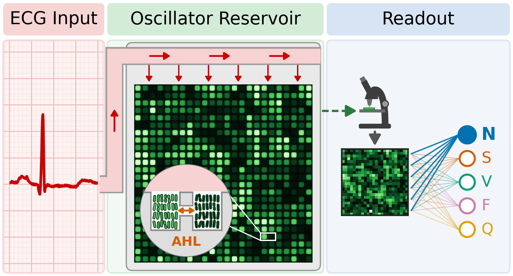
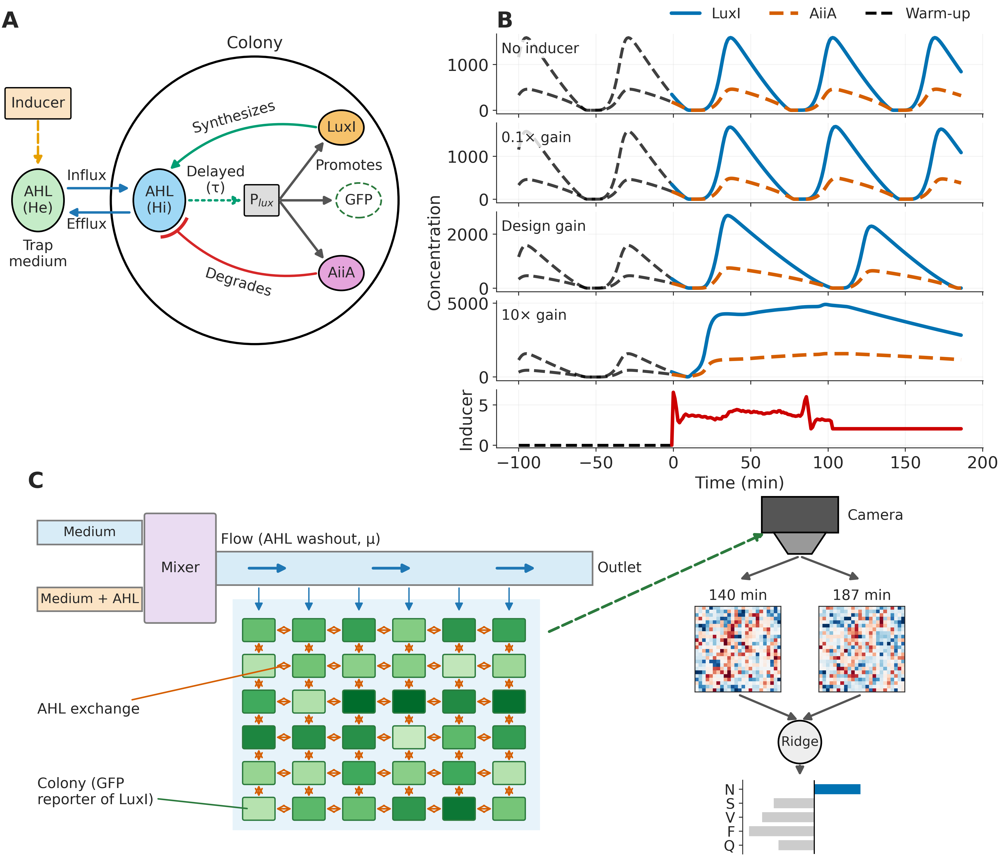
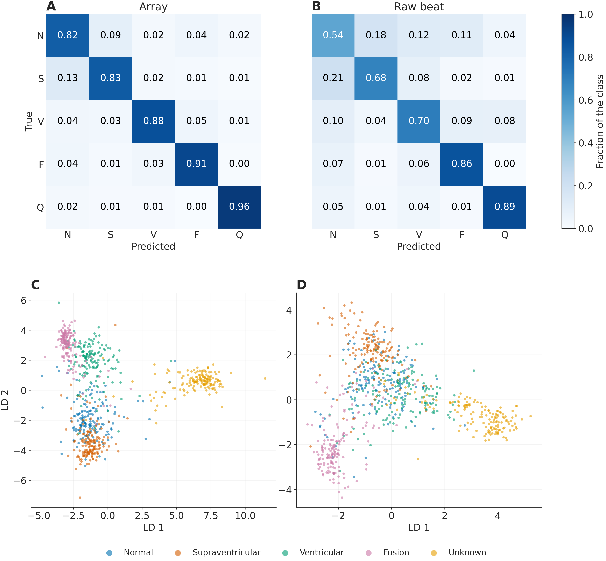
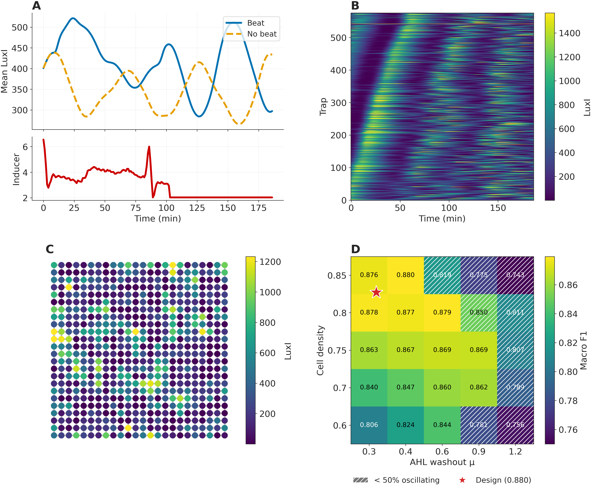

# Reservoir Computing with Genetic Oscillators

[](https://github.com/James-02/bio-reservoir/actions/workflows/tests.yml)
[](https://codecov.io/gh/James-02/bio-reservoir)
[](LICENSE)
[](pyproject.toml)

A framework for reservoir computing with simulated bacterial colonies. Each colony carries
a genetic clock, a quorum-sensing oscillator modelled by delay differential equations. A
time series drives the colonies, their response is measured, and a simple classifier is
trained on the measurements. The reservoir is a
[ReservoirPy](https://github.com/reservoirpy/reservoirpy) `Node`, so it can be used on its
own in Python or through the framework's YAML configs, which run cross-validated
classification tasks, Optuna studies, comparisons between runs and figures, and record how
every result was made.

The built-in task classifies heartbeats from the MIT-BIH arrhythmia database (five AAMI
classes, or normal against arrhythmia).



## How It Works

1. **Colonies.** Each colony is an oscillator of two genes, luxI and aiiA, and the signal
   molecule AHL inside (Hi) and outside (He) the cells, with a delayed negative feedback.
2. **Input.** Each sample of the time series is added to the AHL of the colonies it reaches.
3. **Coupling.** The colonies interact, either through an abstract signed kernel or by
   exchanging AHL through the medium, for example between neighbouring traps of an array
   (see [Model Options](#model-options)).
4. **Measurement.** The colonies' states are read over the series: every variable, or only
   the fluorescent LuxI reporter in a few noisy images, as a microscope would see it.
5. **Readout.** A classifier (ridge, logistic regression, SVM, k-nearest neighbours, random
   forest, gradient boosting and others) is trained on the measurements.



*(A) The gene circuit in each colony. (B) One colony driven by a heartbeat at several input
gains. (C) A trap array: the inducer reaches every trap, the flow washes out AHL,
neighbouring traps exchange it, and a camera images the LuxI reporter.*

## Install

Dependencies are locked in `uv.lock` (Python 3.12), so [uv](https://docs.astral.sh/uv/)
recreates the exact environment:

```bash
export UV_PROJECT_ENVIRONMENT=venv
uv sync --extra dev
source venv/bin/activate
cp config.env.example config.env   # Kaggle credentials and local paths
python -m utils.preprocessing      # download and prepare the MIT-BIH dataset
```

Without uv, `pip install -e .[dev]` installs the pinned dependencies.

## Using the Reservoir in Python

`BioReservoir` is a ReservoirPy node: `run` drives the colonies with a series of shape
`(timesteps, 1)` and returns their states at every step, `units × len(output_variables)`
columns (A, I, Hi and He by default). `reset` returns the colonies to their warmed-up state,
so each series starts from the same state. Any classifier can then read the states:

```python
import numpy as np
from sklearn.linear_model import RidgeClassifierCV

from bioreservoir import BioReservoir
from utils.preprocessing import load_ecg_data

X_train, Y_train, X_test, Y_test = load_ecg_data(rows=1000)   # beats: (n, 187, 1)
reservoir = BioReservoir(units=64, warmup=200, seed=1)

def final_state(beat):
    reservoir.reset()
    return reservoir.run(beat)[-1]

F_train = np.array([final_state(x) for x in X_train])
F_test = np.array([final_state(x) for x in X_test])
readout = RidgeClassifierCV().fit(F_train, Y_train[:, -1].argmax(axis=1))
print(readout.score(F_test, Y_test[:, -1].argmax(axis=1)))
```

`training.cross_validate` runs the same with a ReservoirPy readout over stratified folds and
returns the metrics of each fold:

```python
from reservoirpy.nodes import Ridge
from training import cross_validate

X, Y = np.concatenate([X_train, X_test]), np.concatenate([Y_train, Y_test])
results = cross_validate(BioReservoir(units=100), Ridge(ridge=1e-6), X, Y, folds=5)
```

## Running a Config

A run is described by a YAML config: the task, the reservoir, what is measured, the readout
and the cross-validation folds. For example, 256 colonies in a square trap array that
exchange AHL with their neighbours, read from two noisy images of the LuxI reporter by a
ridge classifier:

```yaml
name: my-run
seed: 1
task: {labels: five-class, rows: 4015, balance_classes: true, scaler: sequence_zscore}
reservoir:
  type: bioreservoir
  params:
    units: 256
    warmup: 500
    rk4_substeps: 32
    input_scaling: 0.15
    input_connectivity: 0.7
    input_bias: false
    bias_scaling: 0.1
    dde_scaling: 0.0006
    cell_coupling: 12.7
    noise_in: 0.0144
    topology_type: lattice
    coupling: diffusion
    diffusion_rate: 1.0
    input_encoding: nonnegative
    input_sign: positive
features:
  variables: [I]
  aggregation: images:2
  measurement_noise: 0.01
readout: {classifier: RidgeCV, scale: true}
cv: {folds: 5}
```

```bash
python -m training.run resolve my-run.yaml              # print the full config, defaults included
python -m training.run run my-run.yaml --processes 8    # simulate and cross-validate
```

Each run writes a folder `results/runs/<name>-<time>/` with its config, metrics (per fold,
mean and sample SD), predictions, figures, log and a manifest (code version, data checksums,
environment), and adds a line to the run registry. Runs from uncommitted code need
`--allow-dirty` and are marked as not citable.

## Configs

The main sections of a run config:

| Section | Sets | Example |
|---|---|---|
| `task` | Labels, pool size, balancing, scaling | `labels: five-class`, `rows: 4015` |
| `reservoir` | Type and parameters, or a study trial | `params: {units: 1024, coupling: diffusion}` |
| `features` | What is measured ([training/observation.py](training/observation.py)) | `variables: [I]`, `aggregation: images:4`, `measurement_noise: 0.01` |
| `readout` | Classifier and its parameters | `classifier: RidgeCV` |
| `cv` | Folds and seed | `folds: 5` |
| `test` | A held-out split to score on | `split: validation-1` |

- A config can start from another with `base: <file>` and list only what differs.
- Each series is simulated once and every fold reads the same features (`cv.simulate: once`).
- Readouts standardise the features on each training fold. `RidgeCV` picks its penalty by
  leave-one-out, and `readout.search` picks hyperparameters on inner folds.
- `reservoir: {type: esn}` is an echo state network, and `reservoir: {type: none}`
  classifies the raw series, the baselines without colonies.
- `aggregation: images_at:155,187` takes an image at each listed step of the series.
- `reference: start` divides each image by the trap's image of the state every series starts
  from (F/F0), which cancels a trap's calibration gain.

### Studies

A config with a `study` section is a seeded Optuna search over its own values. Each trial
runs the same pipeline as a single run and records its full config. For example, a search
over the input gain and the exchange rate of the run above:

```yaml
base: my-run.yaml
name: my-study
study:
  trials: 50
  metric: f1
  sampler: {type: tpe, seed: 1}
  search:
    reservoir.params.input_scaling: {type: float, low: 0.01, high: 0.5, log: true}
    reservoir.params.diffusion_rate: {type: float, low: 0.1, high: 5, log: true}
```

```bash
python -m training.run study my-study.yaml --processes 8        # resumes if it exists
python -m training.run study-table my-study.yaml --group        # one row per point
python -m training.run study-best my-study.yaml --out best.yaml # best trial as a run config
```

A study is stored in `results/optuna/optuna-<name>.db` (or `--storage`). `sampler: {type:
grid}` runs every combination, and `categorical` searches choose between values. With
`reservoir: {states_from: <run>}` a study tunes only the readout on a run's saved states.

### Held-out Evaluation

Three held-out splits of the heartbeat data are kept out of the cross-validation pool:
`validation-1` and `validation-2` (803 beats per class each) and `test` (370 per class).
Their beat IDs and checksums are in [data/splits/heldout.json](data/splits/heldout.json),
and `python -m utils.heldout --check` verifies them. Choose models by cross-validation,
check them on the validation splits, and use `test` once, for the final result:

```yaml
test:
  split: validation-1   # `test` also needs --final-test on the command line
```

## Model Options

All options are off by default, so the defaults change no result. Each table row is one
config change, so the effect of each change can be measured on its own.

**Coupling** (`reservoir.params`):

| Option | Effect |
|---|---|
| `coupling: abstract` | Default: a signed kernel of the colonies' states adds to their input (not chemically realisable) |
| `coupling: diffusion` | Colonies exchange extracellular AHL through the medium; `diffusion_rate` sets the rate |
| `coupling: none` | Independent colonies |
| `topology_type: lattice` | Colonies in a square trap array (diffusion only) |
| `input_encoding: nonnegative`, `input_sign: positive` | The input is a non-negative inducer level |
| `preset: qs_diffusion` | The chemically realisable model: these choices together |

**Realism** (`reservoir.params`, [bioreservoir/realism.py](bioreservoir/realism.py)):

| Option | Effect |
|---|---|
| `param_heterogeneity_cv` | Colony-to-colony variation of the kinetic rates |
| `heterogeneity_density_cv`, `heterogeneity_dilution_cv` | Variation of cell density and washout |
| `washout_rate`, `cell_density` | The AHL washout rate set by the flow (µ, default 0.6) and the cell density (d, default 0.7) of every colony |
| `input_levels: K` | The input reaches the traps at K discrete levels |
| `reset_noise: cv` | Each series starts from a slightly different state |
| `warmup_input: rest` | The colonies warm up at the resting inducer level |

**Controls** ask what the colonies add over simpler feature maps of the series:

| Control | Config |
|---|---|
| Random nonlinear features | `reservoir: {type: random_features, params: {units: 8000}}` |
| A bank of leaky integrators | `reservoir: {type: leaky_bank, params: {units: 24}}` |
| A linear filter fitted to a run's features | `reservoir: {states_from: <run>, surrogate: linear}` |

**Ablations** remove one part of the model:

| Ablation | Config |
|---|---|
| No coupling | `reservoir.params.coupling: none` |
| No feedback delay | `reservoir.params.delay: 0` (default 10 input steps) |
| Scrambled series | `task.scramble: true` |

Controls and ablations use the same pool, folds and readout as the reservoir, so
`training.run compare` pairs them sample by sample.

The colonies are integrated with an explicit RK4 solver. A run refuses a step too long for
the coupling, and stops with `UnstableIntegrationError` if the states blow up; large
heterogeneity needs more substeps (`rk4_substeps: 32` or 64).
`python scripts/analysis/drive_bounds.py <config>` reports a reservoir's drive range.

## Analysing Results

Each run folder holds `metrics.json` (macro F1, accuracy, MCC and others per fold, with the
mean and SD) and `fold-<k>.npz` (labels, predictions and, with `outputs.save_states`, the
features). A run is named by its folder, its registry ID or its folder name under
`results/runs`:

```bash
python -m training.run compare RUN_A RUN_B                 # pair two runs fold by fold
python -m training.run compare RUN_A RUN_B --margin 0.01 --ceiling RUN_C
python -m training.run study-table my-study.yaml --csv trials.csv
python -m utils.provenance list                            # every run, its commit and status
python -m utils.provenance show RUN_ID
python -m utils.provenance diff RUN_A RUN_B
python scripts/analysis/analyse_fold_results.py --glob 'results/runs/my-run-*/fold-*.npz'
```

`compare` recomputes both runs' metrics from their stored predictions. When the runs share
their folds it pairs them sample by sample: per-fold differences, prediction agreement and a
paired bootstrap confidence interval; `--margin` adds a non-inferiority test, and `--ceiling`
the share of the gap from A to a third run C that B closes.



*Five-class heartbeat classification. (A, B) Confusion matrices of a ridge readout on two
images of a 576-colony array and on the raw beat. (C, D) The test beats of one fold projected
onto two linear discriminants, for the array's features and for the raw beat.*

## Visualisations

A run draws its confusion matrix and fold scores into its `figures/` folder, and `compare`
draws both runs side by side. The scripts below draw the model and the data from a run or
study config. Each saves a PNG under `results/figures/<topic>/` (`--formats pdf,svg` adds
more) and warns when text or lines would be too small at the printed size.

| Script | Draws | Input |
|---|---|---|
| [visualise_dde.py](scripts/figures/visualise_dde.py) | One colony driven by a series at several input gains | Run config |
| [visualise_reservoir_states.py](scripts/figures/visualise_reservoir_states.py) | The colonies' states over a series; `--drive` adds the drive they receive | Run config |
| [visualise_topology.py](scripts/figures/visualise_topology.py) | The coupling kernel and its strongest links | Run config |
| [visualise_dataset.py](scripts/figures/visualise_dataset.py) | The class means, added noise and scalings of the data | Run config |
| [visualise_heterogeneity.py](scripts/figures/visualise_heterogeneity.py) | Macro F1 against a swept heterogeneity setting | Study config |
| [analyse_fold_results.py](scripts/analysis/analyse_fold_results.py) | Metric tables; `--plots` adds confusion matrices, scores and PCA | Fold files |
| [drive_bounds.py](scripts/analysis/drive_bounds.py) | The range of the colonies' drive; `--oscillation` their oscillation amplitudes | Run config |

```bash
python scripts/figures/visualise_reservoir_states.py my-run.yaml --var I --drive
python scripts/figures/visualise_dde.py my-run.yaml --formats png,pdf
python scripts/analysis/analyse_fold_results.py --glob 'results/runs/my-run-*/fold-*.npz' --plots
```



*Colony dynamics during one heartbeat. (A) Mean LuxI with and without the beat. (B) LuxI of
every colony. (C) Each colony's LuxI in the final image, on the trap grid. (D) Macro F1 over
the AHL washout rate and the cell density.*

## Outputs

Paths come from [utils/config.py](utils/config.py): environment variable, then `config.env`,
then the default.

| Path | Setting | Contents |
|---|---|---|
| `results/` | `BIORESERVOIR_RESULTS_DIR` | `optuna/` studies, `runs/` run folders, `metrics/` tables, `figures/` |
| `logs/` | `BIORESERVOIR_LOGS_DIR` | Log files |

## Remote Hosts

[optimization/deploy.py](optimization/deploy.py) copies the code to a Linux host over SSH,
installs the locked environment there with `uv`, and runs a study or command in a detached
session; [optimization/collect.py](optimization/collect.py) fetches the results. Host
addresses and the remote workspace are set in `config.env`; hosts are named by label.

```bash
python -m optimization.deploy --host host1 --run 'python -m training.run study my-study.yaml'
python -m optimization.deploy --status
python -m optimization.collect --host host1 --study my-study
```

## Project Structure

| Folder | Contents |
|---|---|
| `bioreservoir/` | The model: DDE solver, `BioReservoir` node, topologies, realism, diagnostics |
| `training/` | Runs, studies, cross-validation, measurement, comparison |
| `optimization/` | Control reservoirs and deployment to remote hosts |
| `utils/` | Data preparation, held-out splits, provenance, settings, plotting |
| `scripts/` | Figure, analysis and experiment scripts |
| `experiments/` | Run and study configs |
| `data/splits/` | Held-out splits (tracked); the rest of `data/` is generated |
| `tests/` | Unit and integration tests (`pytest`) |

See the [CHANGELOG](CHANGELOG.md) for what changed in each version.

## Acknowledgements

- [ReservoirPy](https://github.com/reservoirpy/reservoirpy): `BioReservoir` is a ReservoirPy
  `Node`.
- [Optuna](https://github.com/optuna/optuna): hyperparameter searches.
- Coupled genetic oscillators: [Prindle et al. (2011)](https://doi.org/10.1038/nature10722),
  *A sensing array of radically coupled genetic 'biopixels'*;
  [Danino et al. (2010)](https://doi.org/10.1038/nature08753), *A synchronized quorum of
  genetic clocks*.
- MIT-BIH heartbeats from [Kaggle](https://www.kaggle.com/datasets/shayanfazeli/heartbeat)
  (Shayan Fazeli); [Kachuee et al. (2018)](http://dx.doi.org/10.1109/ICHI.2018.00092),
  *ECG Heartbeat Classification: A Deep Transferable Representation*.
