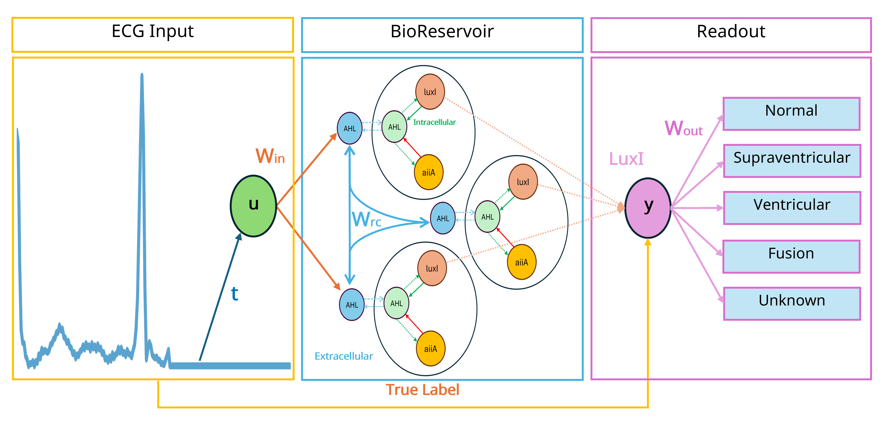
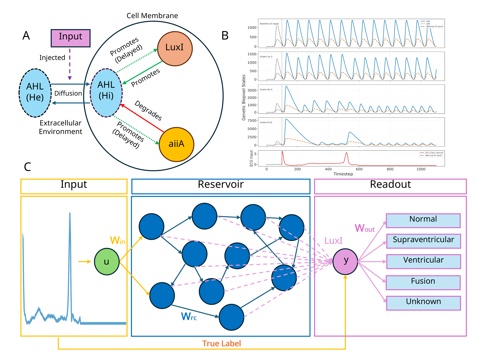
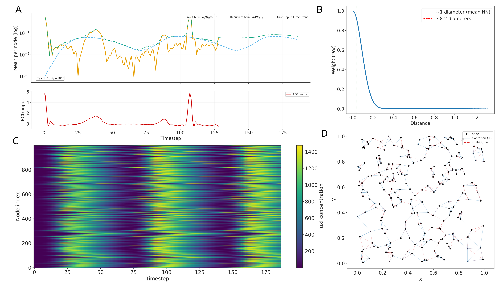
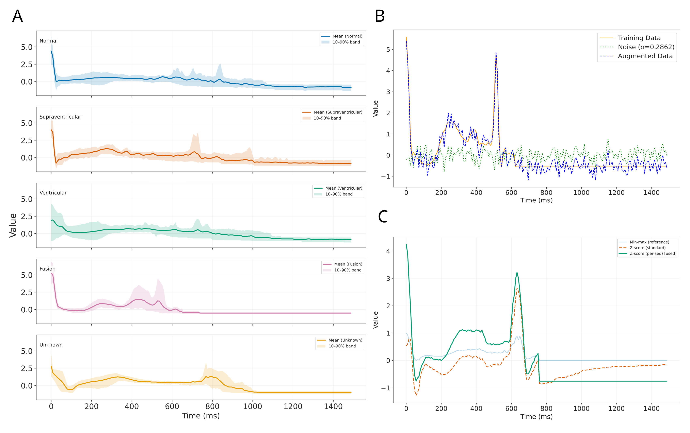
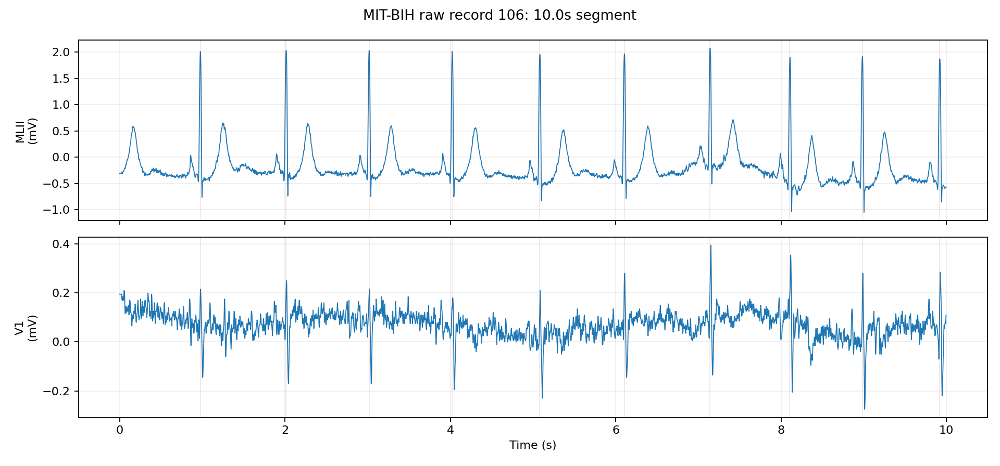
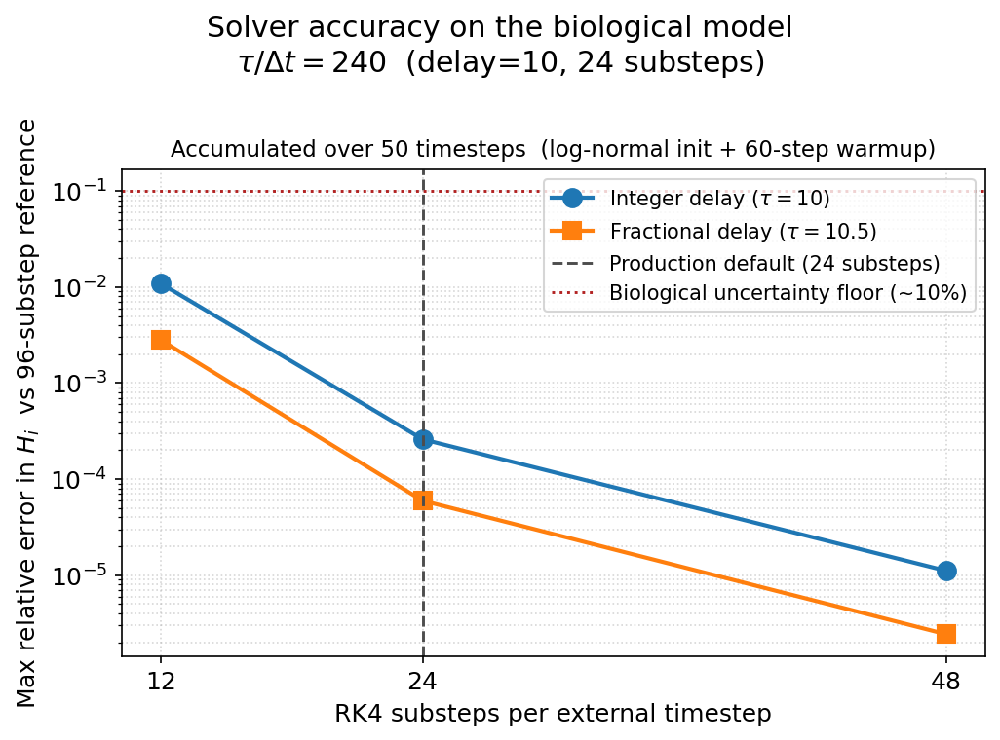
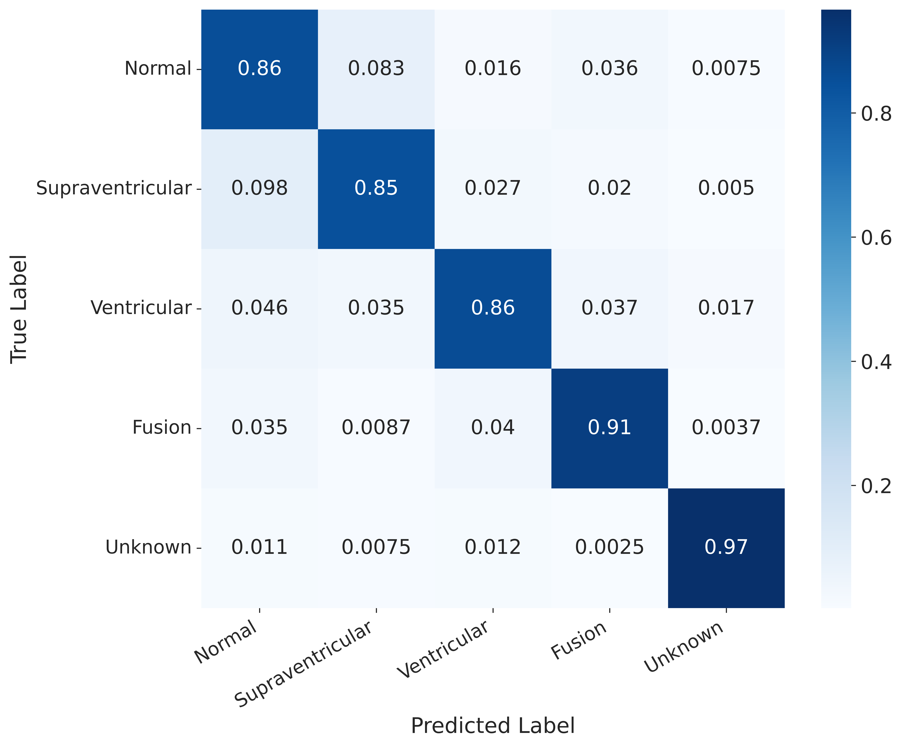
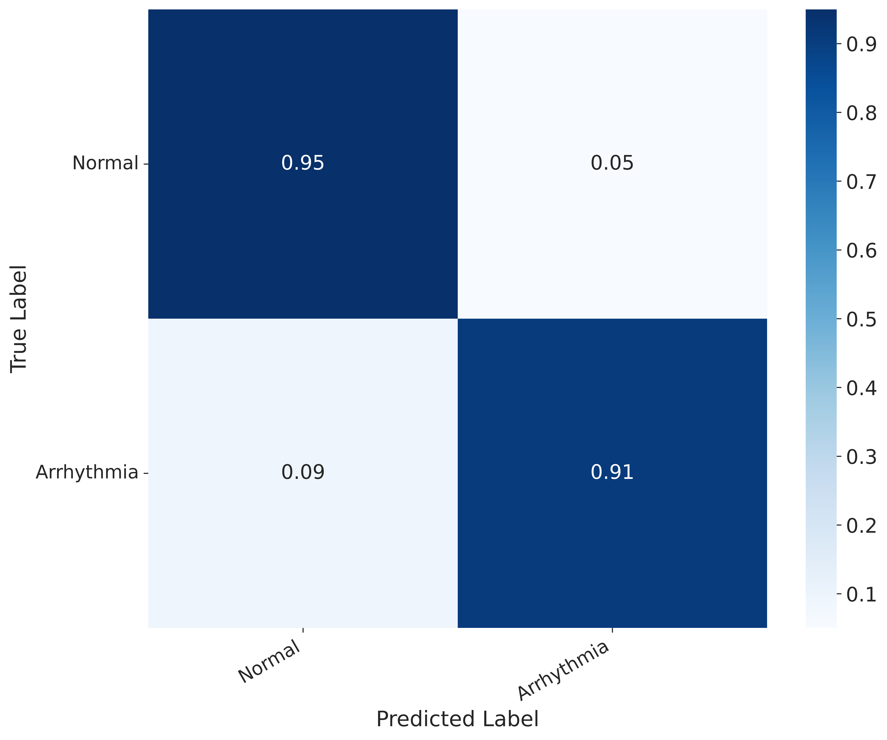
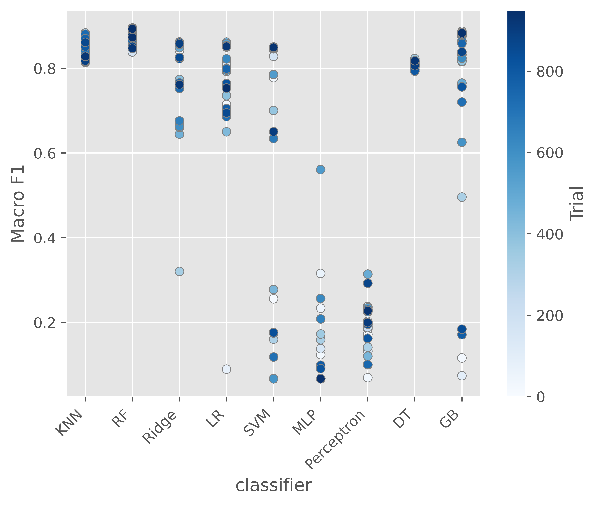

# Reservoir Computing with Genetic Oscillators

[](https://github.com/James-02/bio-reservoir/actions/workflows/tests.yml)
[](https://codecov.io/gh/James-02/bio-reservoir)
[](LICENSE)
[](pyproject.toml)
[](https://doi.org/10.5281/zenodo.23436888)

A reservoir computing framework built on coupled genetic oscillators for ECG arrhythmia classification. Each reservoir node is a quorum-sensing oscillator modelled by delay differential equations (DDEs), implemented as a [ReservoirPy](https://github.com/reservoirpy/reservoirpy) `Node`.

> For a comprehensive overview, see our associated research paper.

## Project Overview



High-level overview of the biological reservoir computing pipeline: ECG sequences perturb quorum-sensing genetic oscillators, the coupled reservoir transforms those inputs into a high-dimensional dynamical state, and a lightweight readout performs the final classification.

## Environment Setup

Dependencies are declared in `pyproject.toml` and locked in `uv.lock` (Python 3.10–3.12), so [uv](https://docs.astral.sh/uv/) recreates the exact environment:

```bash
export UV_PROJECT_ENVIRONMENT=venv
uv sync --extra dev
source venv/bin/activate
cp config.env.example config.env   # Kaggle credentials and local paths
```

Without uv, `pip install -e .[dev]` installs the pinned runtime dependencies.

## Example Usage

```python
from bioreservoir import BioReservoir, distance_matrix
from utils.preprocessing import load_ecg_data
from training import cross_validate
from utils.analysis import compute_mean_metrics

# Load arrhythmia ECG data (balanced 5-class)
X_train, Y_train, X_test, Y_test = load_ecg_data(rows=1000)

# Initialise reservoir and readout
import reservoirpy as rpy
from reservoirpy.nodes import Ridge

reservoir = BioReservoir(units=100)
readout = Ridge(ridge=1e-6)

# Combine train+test for cross-validation
import numpy as np
X = np.concatenate([X_train, X_test])
Y = np.concatenate([Y_train, Y_test])

# 5-fold cross-validation
results = cross_validate(reservoir, readout, X, Y, folds=5)
```

The notebook [docs/tutorial.ipynb](docs/tutorial.ipynb) is a guided tour at small size: the model and its diagnostics, run configs, per-fold, per-class and timing metrics, run comparisons, the data and the held-out splits, optimisation studies, and the checks against `v0.1`.

## Running Experiments

A run is defined by a YAML config: the task (labels, pool size, balancing, scaling), the reservoir (explicit parameters or an Optuna study trial), the state features, the readout and the cross-validation. The configs of the `v0.1` headline runs are in [experiments/benchmarks/v0.1](experiments/benchmarks/v0.1).

```bash
python -m training.run run experiments/benchmarks/v0.1/balanced.yaml --processes 5
python -m training.run resolve my-config.yaml          # print the explicit config
python -m training.run compare archive:v0.1/P4-readout-balanced-best results/runs/<run>
python -m utils.provenance list                        # the run registry
python -m utils.provenance mark <run id> ok --uses "Table 2, balanced"
```

Each run writes `results/runs/<name>-<UTC time>/`: the resolved `config.yaml`, `metrics.json` (per fold, mean and sample SD, pooled), `fold-<k>.npz`, `figures/`, `run.log` and `manifest.json` (code version, data checksums, environment), and adds a line to `registry.jsonl`. Runs from uncommitted code need `--allow-dirty` and are marked non-citable. `compare` prints per-fold metrics, the prediction agreement and a paired bootstrap 95% CI of the macro-F1 difference, and saves figures with `--out`. `optimize rerun-best` and `optimize apply-best` use the same runner.

### Held-out evaluation

Besides the cross-validation pool, three held-out splits of the five-class dataset hold beats (N, S, V and Q) that no `v0.1` optimisation study used: `validation-1` and `validation-2` (803 beats per class each) and `test` (370 beats per class). Their beat IDs and checksums are tracked in [data/splits/heldout.json](data/splits/heldout.json); `python -m utils.heldout --check` rebuilds them from the data and verifies them. Select models by cross-validation on the pool; use the validation splits to check how a choice generalises, and the `test` split once, for the final evaluation.

A run evaluates on a split when its config has a `test` section; the readout is then fitted on the whole pool and scored on the split (macro F1 over the split's classes, with a bootstrap 95% CI):

```yaml
test:
  split: validation-1   # or validation-2, or test (needs --final-test)
```

```bash
python -m training.run run my-config.yaml                # validation split
python -m training.run run my-final-config.yaml --final-test
```

The run refuses beats of the split that are also in its pool, records the split's beat IDs in the manifest and the split in the registry, and runs on the same split pair beat by beat in `compare`.

`pytest -m benchmark` reruns the `v0.1` headline configs and compares them fold by fold with the archived runs; it needs a capable host (`BIORESERVOIR_BENCHMARK_PROCESSES` sets the parallel folds). The balanced, unbalanced, binary-full and ESN reruns reproduce the archived predictions exactly. The binary-full config reads the binary file the `v0.1` runs used (`data/ecg_archive/binary_ecg_data.npz`, a pre-balanced pool of 37,714 beats, checked by its SHA-256); it is not built by `python -m utils.preprocessing`, and without it the binary tests are skipped.

The code defaults include the fixes listed in the [CHANGELOG](CHANGELOG.md) (one position per oscillator, the delay resolved at every RK4 substep, unit spectral radius, scaled readout features, and others). `preset: v0.1` in a run config, which the benchmark configs use, restores the v0.1 code path; the ablation and heterogeneity scripts take `--preset v0.1`. `python scripts/analysis/drive_bounds.py <config>` reports a reservoir's drive range, negative states and drive shares.

## Project Structure

- **bioreservoir/** — Core library: DDE solver, `BioReservoir` node, topology generation (distance-based spatial kernels).
- **training/** — Cross-validation pipeline, classification helpers, profiling utilities.
- **optimization/** — Optuna hyperparameter studies, study registry, and CLI commands for running/evaluating studies.
- **utils/** — Preprocessing (ECG loading, augmentation, scaling), analysis metrics, visualisation, and result management.
- **scripts/** — Standalone experiment scripts and analysis helpers.
- **experiments/** — Run configs (`benchmarks/v0.1/`: the `v0.1` headline runs).
- **data/ecg/** — MIT-BIH arrhythmia dataset files (not tracked; `python -m utils.preprocessing`).
- **data/splits/** — Held-out validation and test splits (beat IDs and checksums, tracked).
- **results/** — Working outputs (gitignored): Optuna studies, fold runs, metrics and figures; see [Results Layout](#results-layout).
- **logs/** — Log files from studies and experiment scripts (gitignored).

## How It Works

1. **Genetic oscillator nodes** — Each node simulates two coupled genes (luxI and aiiA) that produce an intracellular AHL signal (Hi) which diffuses externally (He). The system is driven by a system of DDEs with delayed negative feedback.

2. **External input** — ECG time-series samples are fed through He, representing the influence of the extracellular environment on the oscillator dynamics.

3. **Reservoir network** — A spatial topology of oscillator nodes is constructed with distance-dependent coupling weights (a Gaussian kernel of distance, with random signs and sparsity, normalised to unit spectral radius).

4. **State extraction** — At each timestep the concentration of each node's luxI gene is read out, producing a high-dimensional state representation of the input.

5. **Classification** — A readout layer (Ridge, KNN, or Random Forest) is trained on the final reservoir states to classify the input into arrhythmia categories.

## Visualisation

### Biopixel Reservoir Model


**(a)** Schematic of a quorum-sensing genetic oscillator (biopixel) comprising luxI, aiiA, intracellular AHL (Hi), and extracellular AHL (He). **(b)** Effective input scales showing how external ECG drive and recurrent coupling modulate gene expression dynamics. **(c)** Reservoir computing architecture: ECG time-series inputs are fed through a network of coupled oscillator nodes, and the final luxI concentrations are read out for classification.

### Reservoir Dynamics and Topology


Characterisation of reservoir dynamics and spatial topology. Panels show the relative magnitude of input and recurrent drive contributions, reservoir state heatmaps over time, distance-based spatial weight kernels, and topology connectivity structure.

### ECG Dataset and Preprocessing


**(a)** Class-averaged ECG waveforms for each heartbeat category with 10–90% percentile bands showing intra-class variability. **(b)** Additive Gaussian noise augmentation applied to a single ECG instance. **(c)** Effect of different preprocessing scalers on the input waveform shape.

### Raw MIT-BIH ECG Segment


Example 10-second segment of a raw MIT-BIH record, showing the morphology and annotation context before conversion into single-beat classification instances.

### DDE Solver Validation


Convergence analysis of the RK4 DDE solver, validating numerical accuracy across step sizes.

### Classification Results (Balanced 5-Class)


Aggregated confusion matrix across five folds for the balanced five-class arrhythmia task (N=1000, KNN k=4, distance-weighted). Off-diagonal values indicate common misclassification patterns.

### Classification Results (Binary)


Aggregated confusion matrix across five folds for the binary Normal vs Arrhythmia task (N=1000, Random Forest).

### Hyperparameter Optimisation


Updated Optuna slice plot generated from the training study evaluation command for the Phase 2 joint optimisation (P2-distance, distance-based topology). Each panel shows per-trial macro F1-score as a function of one hyperparameter.

### Readout Optimisation


Optuna slice plot generated from the balanced readout optimisation study (P4-readout-balanced), showing how classifier-specific hyperparameters affect macro F1 across the frozen-state readout search.

## Optimisation CLI

Use the unified optimisation CLI to run studies, inspect the best trials, and regenerate diagnostic plots. See `python -m optimization.optimize --help` for the full option set.

Study names follow Supplementary Table S5 (`P1-scaling`, `P2-distance`, `P4-readout-balanced`, `ESN-balanced`, `B1-balanced`, ...), and each study is stored in `results/optuna/optuna-<study>.db`.

### Run Studies

```bash
python -m optimization.optimize research --type training --study P2-distance --processes 32
python -m optimization.optimize research --type readout --study_name P4-readout-balanced --trial_name P2-distance-best --processes 32
```

### Evaluate Studies

```bash
python -m optimization.optimize evaluate --type readout --study_name P4-readout-balanced --plots slice --show metrics
python -m optimization.optimize evaluate --type training --study P2-distance --plots slice --show metrics
```

Both commands generate plots into `results/figures/optimization/`.

### Results Layout

Paths and settings come from [utils/config.py](utils/config.py). Each setting is read from the environment first, then from an optional `config.env` file (copy [config.env.example](config.env.example)), then the default. Relative paths resolve against the repository root.

| Default path | Setting | Contents |
|---|---|---|
| `results/optuna/` | `BIORESERVOIR_RESULTS_DIR` (root) | Optuna studies, `optuna-<study>.db` |
| `results/runs/<run>/` | | Run folders: `config.yaml`, `metrics.json`, `fold-<k>.npz`, `figures/`, `run.log`, `manifest.json` |
| `results/metrics/` | | Derived metric tables and statistics |
| `results/figures/<topic>/` | | Figures |
| `logs/` | `BIORESERVOIR_LOGS_DIR` | Log files, `<command>-<study>-<UTC time>.log` |
| `archive/<version>/` | `BIORESERVOIR_ARCHIVE_DIR` (root) | Frozen results of a released version |

An archive has the same `optuna/`, `runs/` and `metrics/` folders, plus `MANIFEST.csv` (what each file supports in the paper) and `SHA256SUMS`. Archives are read-only and are not part of the repository; new outputs always go to `results/` and `logs/`. To inspect an archived study or run:

```bash
python -m optimization.optimize evaluate --type training --study P2-distance --archive v0.1
python scripts/analysis/analyse_fold_results.py --glob 'archive/v0.1/runs/P4-readout-balanced-best/fold-*.npz' --plots confusion
```

### Host-Agnostic Reproducibility Scripts

Some studies are intentionally script-driven rather than Optuna-driven. These remain reproducible because they are self-contained Python entrypoints with no host-specific orchestration:

- [scripts/run_ablation.py](scripts/run_ablation.py) — Ablation conditions with fixed reservoir and RF readout.
- [scripts/run_heterogeneity.py](scripts/run_heterogeneity.py) — Parameter heterogeneity robustness grid.

Run these locally in the same Python environment as the optimisation CLI.

### Remote Deployment

[optimization/deploy.py](optimization/deploy.py) runs studies or commands on remote hosts in a detached session, and [optimization/collect.py](optimization/collect.py) copies the databases, run folders and logs back. Each host needs RHEL 9 (or a compatible distribution) with Python 3.10–3.12, `ssh` and `rsync`, and key-based SSH login. Host addresses, the SSH user and the remote workspace are set in `config.env` (see [config.env.example](config.env.example)); hosts are otherwise referred to by label (`host1`, ...), and every remote run records its label, CPU model, core counts and RAM with its results.

```bash
python -m optimization.deploy --inventory          # hardware per host -> results/metrics/hosts.json
python -m optimization.deploy --host host1 --study P2-distance
python -m optimization.deploy --status
python -m optimization.collect --host host1 --study P2-distance
```

> [!TIP]
> Use `--help` to see what else is available

Example output from the readout evaluation:

```text
========================================================================
  ALL classifiers — P4-readout-balanced
========================================================================
    f1  trial classifier rf_criterion  rf_max_depth rf_max_features  rf_min_samples_leaf  rf_min_samples_split  rf_n_estimators rf_oob_score  accuracy     f1  f1_macro   f1_std  f1_weighted  kappa    mcc  n_folds  precision  precision_macro  precision_weighted primary_average  recall  recall_macro  recall_weighted  runtime
0.8953    833         RF     log_loss            23            sqrt                    1                     2              326         True    0.8949 0.8953    0.8953  0.00737       0.8953 0.8686 0.8691        5     0.8973           0.8973              0.8973           macro  0.8949        0.8949           0.8949    243.7

  Summary — top   10: mean=0.8950  std=0.0002  min=0.8948  max=0.8953
  Summary — all   946: mean=0.8108  std=0.2076  min=0.0665  max=0.8953
```

Example output from the training evaluation:

```text
========================================================================
	study — P2-distance
========================================================================
		f1  trial  cell_coupling  dde_scaling  fade_alpha  input_connectivity  input_scaling  p_excite  rc_scaling  sparsity  units  warmup  accuracy     f1  precision  recall  runtime
0.9047    416          12.75    0.0006439   2.803e-05              0.5282         0.0277    0.8354    0.007036     0.576   1000      50    0.9041 0.9047     0.9096  0.9041     2401

	Summary — top   10: mean=0.9014  std=0.0019  min=0.8988  max=0.9047
	Summary — all   768: mean=0.8481  std=0.0748  min=0.1924  max=0.9047
```

## Acknowledgements

**ReservoirPy** — Our `BioReservoir` class extends the ReservoirPy `Node` class.
- [reservoirpy](https://github.com/reservoirpy/reservoirpy)

**Optuna** — Hyperparameter optimisation framework used for study-based tuning.
- [Optuna](https://github.com/optuna/optuna)

**Genetic Oscillators** — Our approach builds upon research into coupled genetic oscillators within bacterial colonies:
- [A sensing array of radically coupled genetic 'biopixels'](https://doi.org/10.1038/nature10722) — Prindle et al. (2011)
- [A synchronized quorum of genetic clocks](https://doi.org/10.1038/nature08753) — Danino et al. (2010)

**Arrhythmia Dataset** — MIT-BIH dataset from Kaggle:
- [Kaggle Heartbeat Dataset](https://www.kaggle.com/datasets/shayanfazeli/heartbeat) — Shayan Fazeli
- [ECG Heartbeat Classification: A Deep Transferable Representation](http://dx.doi.org/10.1109/ICHI.2018.00092) — Kachuee et al. (2018)
